# sketch (for Antigravity / AGY)

English | [繁體中文](README.zh-TW.md)

**Antigravity answers with pictures instead of paragraphs.**

`sketch` is a native Google Antigravity (`agy`) plugin ported from [`claude-code-sketch`](https://github.com/allen-hsu/claude-code-sketch). It gives your Antigravity agent **17 drawing tools**, an interactive **MCP App UI (`ui://sketch/card.html`)**, a **CLI TUI inline renderer hook**, and a standing rule: when an answer has a shape, draw the shape. Architecture, flows, roadmaps, user journeys, wireframes, and charts appear as visual cards directly in your conversation, matching your theme's colors.


## Diagrams you can explore

A dense diagram stays readable because you can ask it about one node at a time:


- **Hover** a node: every wire leaving it lights up, end to end.
- **Click** a node's name (anywhere across the middle of its box, or its name in the list under a dense picture): its wires in and out turn thick, sit on top of everything else, and a pulse runs along them from source to target; the rest fades. Click it again to clear it, or click another node to move the focus. Each card keeps its own focus.
- Every node's wires have their own color, and where two wires cross, the later one simply passes over the earlier: no junction marks that could be mistaken for a connection.
- Past a handful of crossings, every connection is also written out under the picture.
- Text too long for its box (a pipeline job, a swimlane step, a node's name or note, a roadmap item) takes a second line where it can; whatever still does not fit shows whole on the line under the card while you hover it.

The pulse runs for 30 seconds after the last click and then stops, leaving the thick lines; it redraws the focused card a few times a second while it runs.

## Install

### Option 1: Install via `agy` CLI

```bash
agy plugin install https://github.com/Doubletaps76/agy-sketch-plugin
```

Or install from a local clone:

```bash
git clone https://github.com/Doubletaps76/agy-sketch-plugin.git
agy plugin install ./agy-sketch-plugin
```

### Option 2: Direct Global Plugin Directory

Clone or copy directly into your Antigravity global plugins directory (`~/.gemini/config/plugins/sketch`):

```bash
git clone https://github.com/Doubletaps76/agy-sketch-plugin.git ~/.gemini/config/plugins/sketch
```

Then just ask as usual: *"how is this service put together?"*, *"compare these three options"*, *"plan the next quarter"*. Antigravity picks the card automatically.

## What you get

| Tool | Draws | Good for |
| --- | --- | --- |
| `layers` | Bands of components, nested zones, side concerns | Tech stacks, platform maps, deployment topologies |
| `diagram` | Nodes and wires, laid out automatically | Architecture wiring, flowcharts, state machines, boundaries (C4), dependencies |
| `schema` | Boxes with fields, and their relations | Data models (ER), class and component diagrams |
| `swimlane` | Steps across lanes of roles or systems | Processes with handovers |
| `pipeline` | Stages left to right, each a column of jobs | CI/CD, ETL, data flows |
| `gitgraph` | Branches, commits, merges and tags | Branching strategy, release flow |
| `sequence` | Actors and the messages between them | Request flows, protocols, handoffs |
| `tree` | An outline or a mind map | Goal breakdowns, sitemaps, taxonomies |
| `timeline` | Bars over periods, milestones | Roadmaps, gantt schedules, study plans |
| `board` | Columns of cards | Kanban, now / next / later |
| `quadrant` | Points on two axes, or four lists | Prioritisation, positioning, SWOT |
| `journey` | Stages, a mood line, rows of notes | User journeys, service blueprints |
| `wireframe` | A low-fidelity screen | Page and app layouts |
| `metrics` | Number tiles with a trend | KPIs, experiment results |
| `chart` | Bar, column, stacked, line, scatter, heatmap, histogram, funnel, share | Any numbers you already have |
| `cards` | Titled cards with tags and quotes | Personas, research findings, principles |
| `compare` | Options side by side, then a pick dialog | Decisions between two to four options |

The cards below are drawn from the sample inputs in [`preview/samples.en.ts`](preview/samples.en.ts). Labels can be in any language; Chinese, Japanese and Korean text is measured correctly (see the [繁體中文 README](README.zh-TW.md) for the same cards in Chinese).

## Architecture and structure

`layers` shows what a system is made of. `diagram` shows how it connects: each node's wires have their own color, an edge that loops back is drawn with an upward arrow, and a node's shape says what it is (decision, store, external system). `numbers: true` numbers the nodes and marks each arrow with where it comes from.

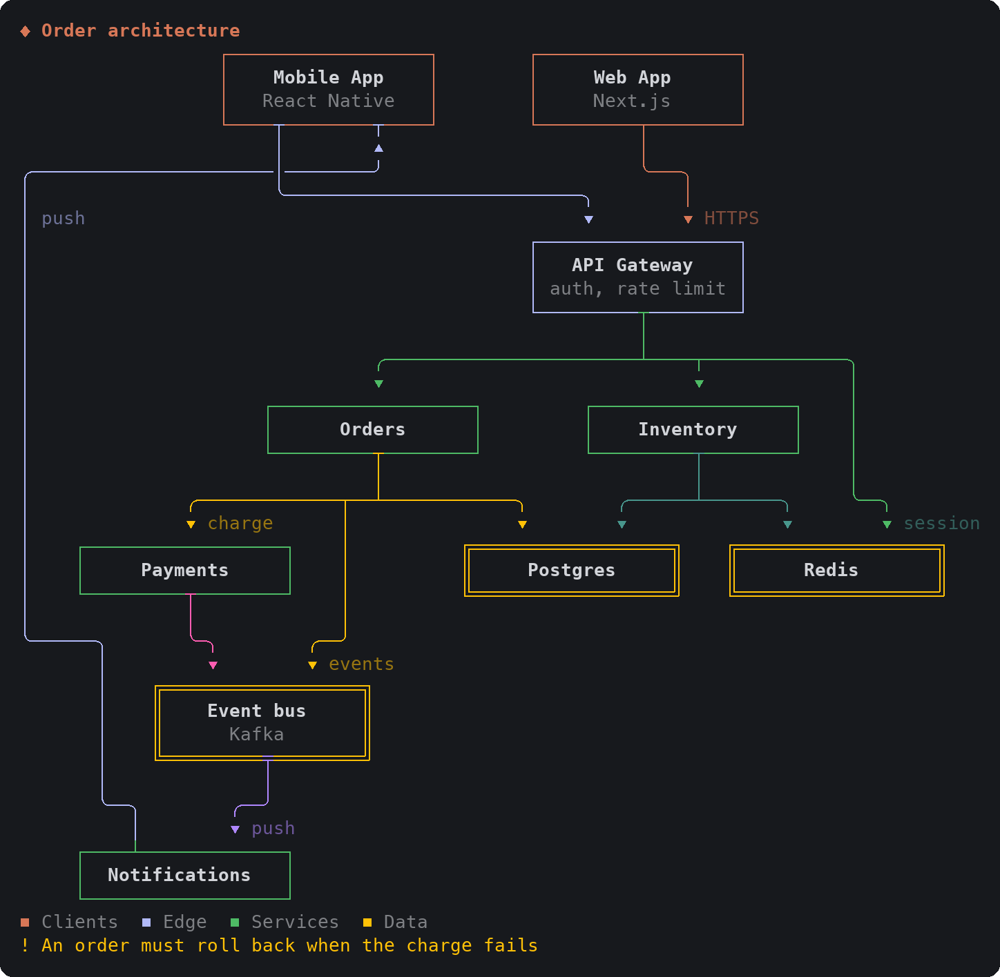

| Flowchart | Dependencies |
| --- | --- |
| 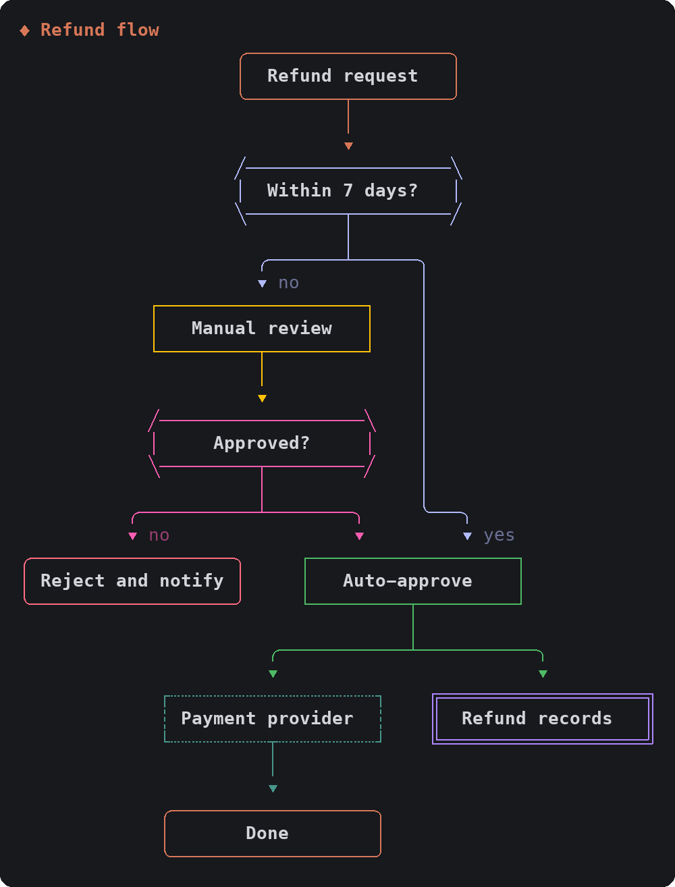 |  |

When dependencies are too dense for wires, `layout: "matrix"` draws who uses whom as a grid, with counts:

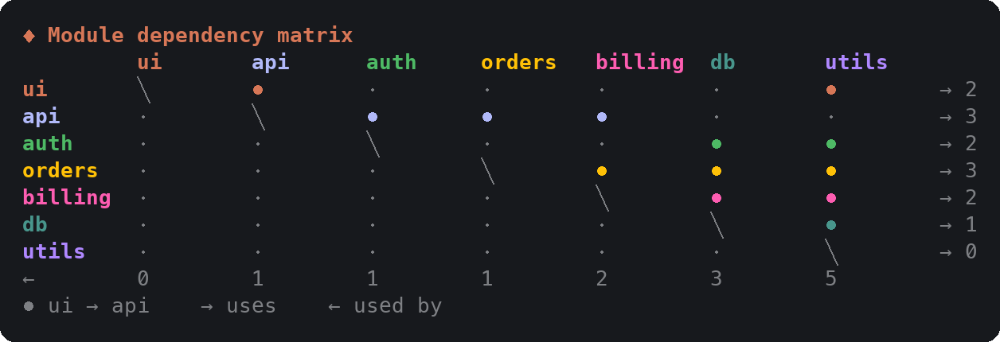

With `layout: "zones"`, each group becomes a framed band: subsystems, network boundaries, a C4 container view. The `person` shape marks a user or a role.

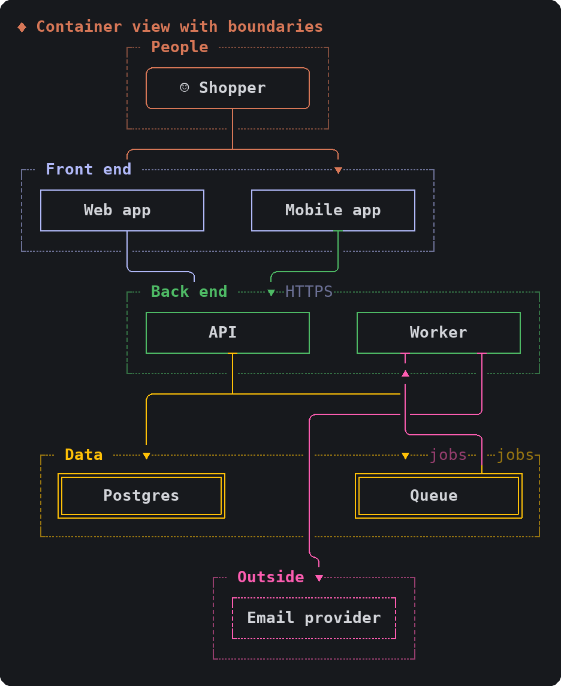

An edge from a node to itself is drawn as a loop inside the node, so a state machine is a diagram too:

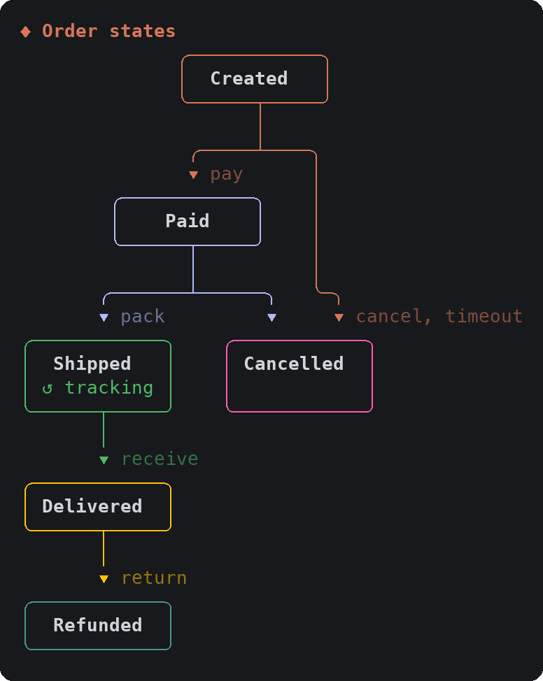

Zones in `layers` can hold zones of their own, which covers deployment topologies (region, availability zone, subnet):


`schema` draws tables or classes with their fields, and the relations between them:

| Data model (ER) | Classes |
| --- | --- |
| 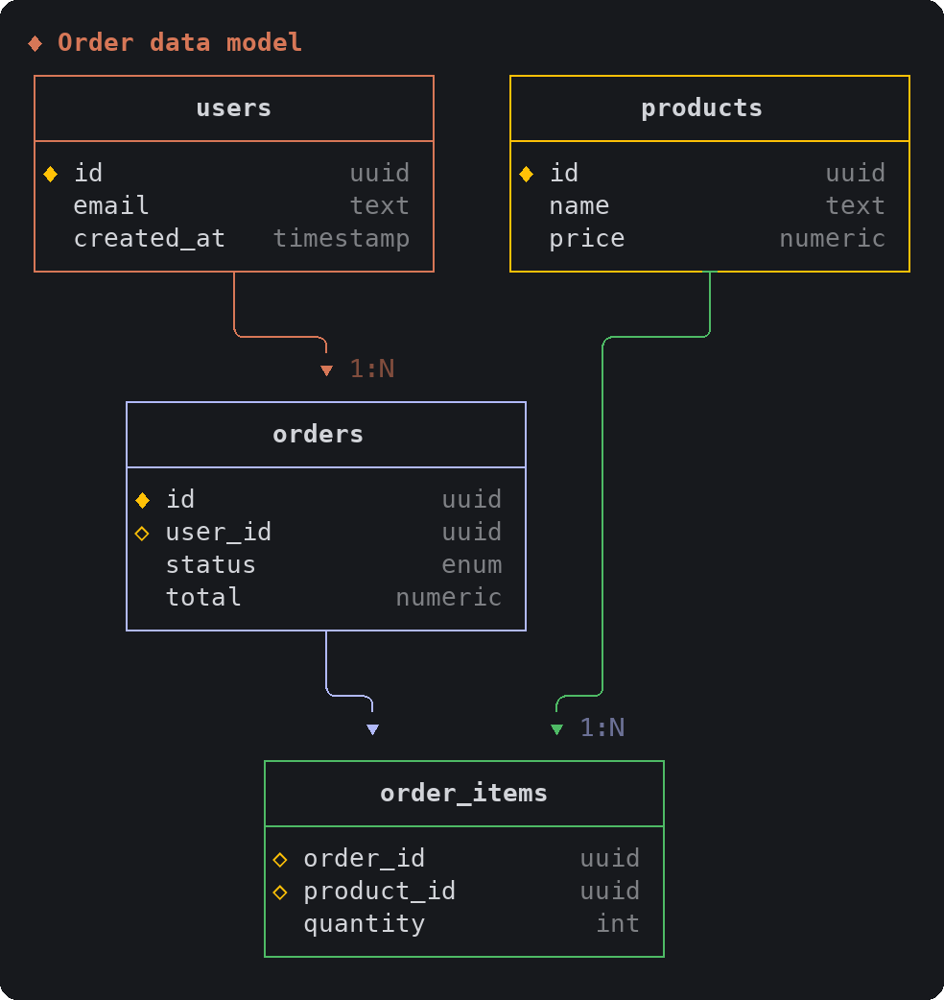 |  |

`swimlane` puts each step of a process in the lane of whoever does it, `pipeline` lays stages out left to right, and `gitgraph` shows branches over time:


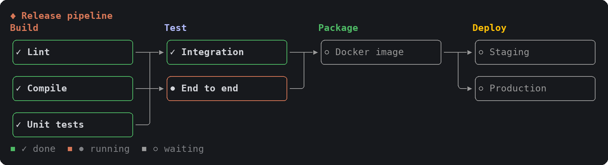


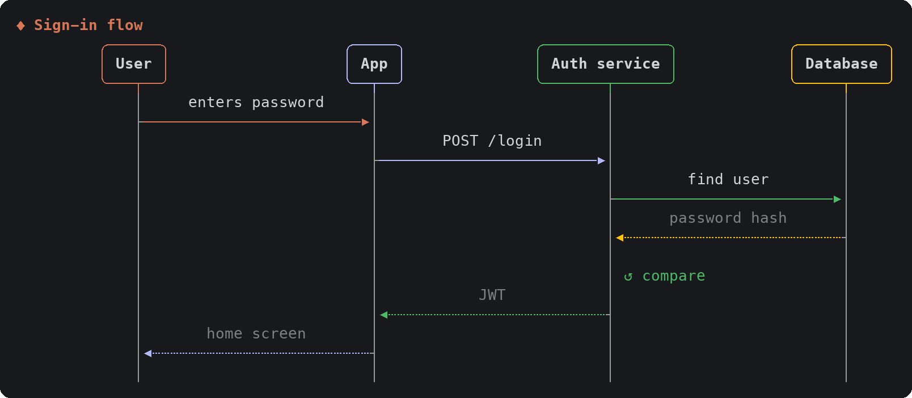

| Outline | Mind map |
| --- | --- |
| 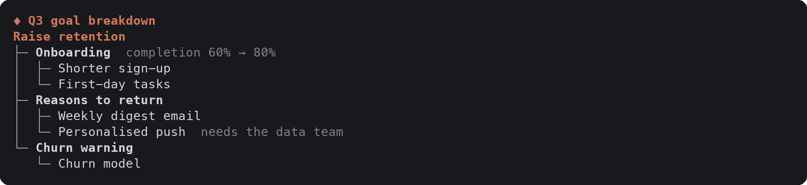 | 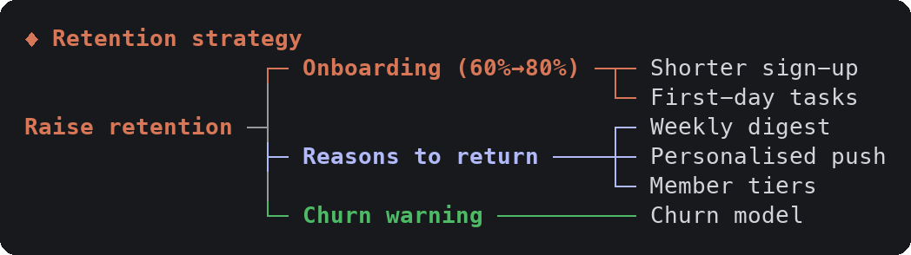 |

## Product and planning


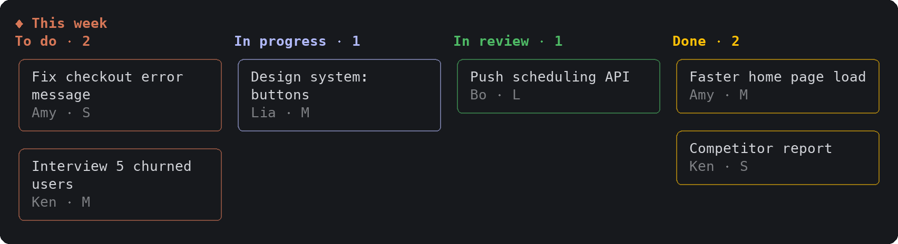


`compare` draws the options side-by-side and presents an interactive selector under the cards so you can pick your preferred option with a click.


## Design and research

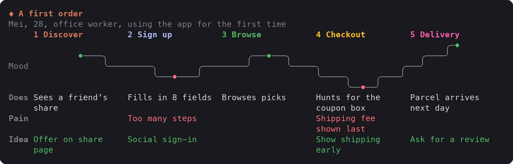


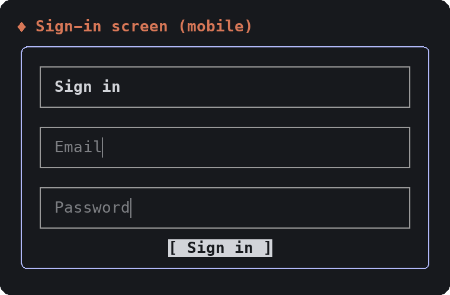


## Numbers

Charts, metric tiles, timelines and journeys draw themselves in smoothly when rendered:


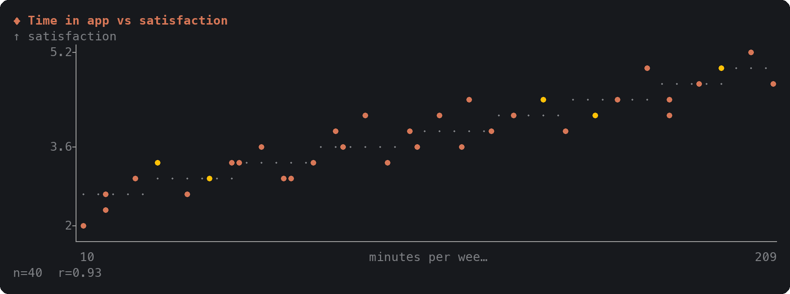

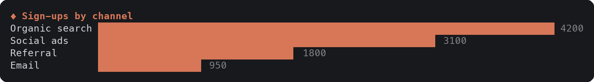

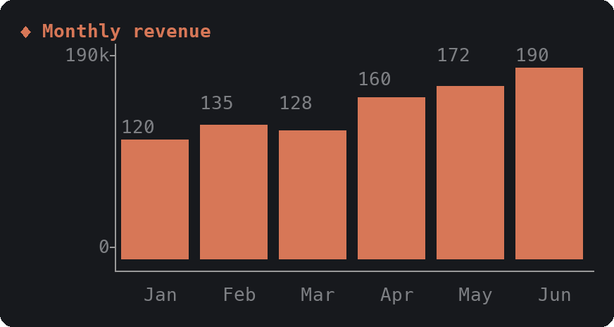


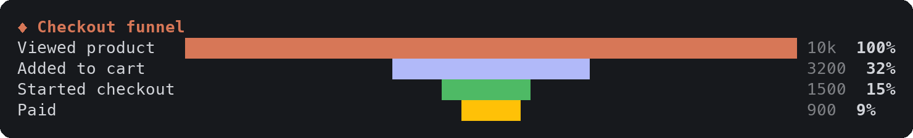

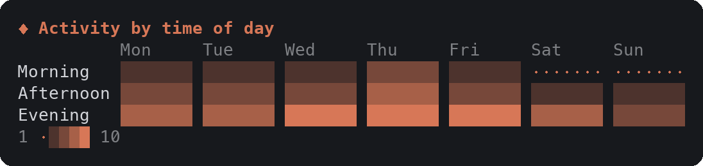

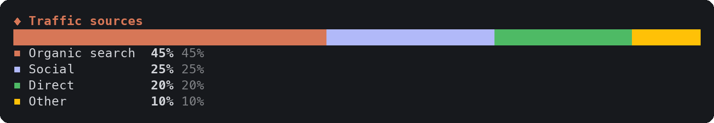

## How it works in Antigravity (`agy`)

The plugin packages four native Antigravity customization layers into one self-contained unit:

1. **Core Layout & Drawing Engine ([`src/engine.ts`](src/engine.ts))**: Implements all 17 structured card parsers, Sugiyama layered graph routing, Braille high-resolution chart plotters, CJK wide-character cell measurement, and flex box layout.
2. **MCP Server ([`src/mcp-server.ts`](src/mcp-server.ts) & [`mcp_config.json`](mcp_config.json))**: Exposes all 17 tools over stdio JSON-RPC and serves the interactive MCP App resource at `ui://sketch/card.html` (`text/html;profile=mcp-app`).
3. **Interactive MCP App UI ([`src/app-ui.ts`](src/app-ui.ts))**: Renders cards inline in Antigravity 2.0 and Antigravity IDE using high-DPI HTML5 Canvas geometric strokes (matching `paint.py`), with hover wire lighting, click-to-focus heavy wires with 30-second pulse flow animation, entrance animations, interactive `compare` option picking, light/dark theme sync, and one-click Copy Text / Save PNG buttons.
4. **CLI Hook & Standing Rules ([`hooks.json`](hooks.json), [`rules/AGENTS.md`](rules/AGENTS.md), [`skills/sketch/SKILL.md`](skills/sketch/SKILL.md))**: Injects rendered box-drawing cards inline in the `agy` terminal TUI via `metadata.user_markdown` (without adding tokens to the model context) and instructs the agent when to reach for each visual card.

## Regenerating preview images

To regenerate the preview cards and animations (requires Node.js 22+ and Python 3 with Pillow):

```bash
node preview/render.ts src/engine.ts 110 preview/cards.json ./samples.en.ts
python3 preview/paint.py preview/cards.json docs/images/en
node preview/frames.ts src/engine.ts 110 ./samples.en.ts preview/anim
SKETCH_GIF_SCALE=0.55 python3 preview/paint.py preview/anim-interaction.frames.json docs/images/en/interaction.gif
python3 preview/paint.py preview/anim-entrance.frames.json docs/images/en/entrance.gif
```

## Develop & Validate

```bash
npm run build                # Compile zero-dependency bundles into bin/
npm test                     # Run test suite across all 17 tools, samples, and MCP server
agy plugin validate . --strict
```

## License

MIT
