# agy-sketch-plugin

English | [繁體中文](README.zh-TW.md)

**Google Antigravity (`agy`) answers with structured visual cards instead of long paragraphs.**

`agy-sketch-plugin` is a native **Google Antigravity (`agy`)** plugin adapted from [`claude-code-sketch`](https://github.com/allen-hsu/claude-code-sketch). It brings all **17 drawing tools and the layout engine** to Antigravity as an **MCP Server + Standing Rules + Skill + Interactive HTML5 Canvas Viewer**, turning architecture explanations, flows, roadmaps, user journeys, wireframes, and quantitative charts into scannable visual cards.

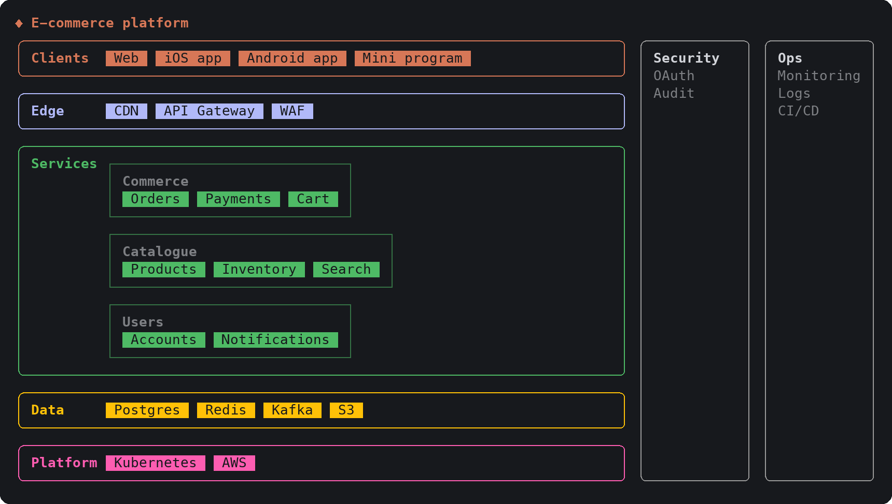

---

## Architecture Comparison: Claude Code vs. Antigravity (`agy`) Terminal Rendering

Because **Claude Code** and **Google Antigravity (`agy`)** have fundamentally different terminal UI (TUI) rendering engines and plugin architectures, `agy-sketch-plugin` operates differently from `claude-code-sketch`:

| Dimension | Claude Code (`claude-code-sketch`) | Google Antigravity (`agy-sketch-plugin`) |
| :--- | :--- | :--- |
| **Underlying TUI Engine** | **Node.js / Bun + React (Ink)** virtual DOM tree | **Native Go binary + BubbleTea** terminal UI engine |
| **Terminal UI Hooks** | Exposes an internal `ui.render` (`ToolUse`) JSX hook that lets a mod replace a transcript row with custom `<ui.Box>`, `<ui.Text hover>`, and `<ui.Button onPress>` components receiving terminal mouse events | **Does not expose** custom Go/JSX TUI component injection inside terminal rows; plugins extend the agent via **MCP Servers (`mcp_config.json`)**, **Rules (`rules/AGENTS.md`)**, **Skills (`skills/`)**, and **Web MCP Apps (`ui://`)** |
| **In-Terminal (`agy` CLI) Display** | Replaces the tool call row in-place with an interactive TUI widget | In the `agy` CLI, MCP tool call rows are collapsed into a single summary line by default. `sketch-mcp` computes the **Unicode Box-Drawing card** and instructs the agent (via `rules/AGENTS.md`) to **output the drawn card verbatim inside a fenced code block** in its reply. (Because terminal code blocks are plain text, in-place mouse hover/click redraws do not happen inside the terminal text block itself.) |
| **Interactive Exploration (Hover Wires / Click Pulse)** | Directly inside the fullscreen terminal via mouse reporting | **Dual-Track Interactive Rendering**:<br>1. **Antigravity IDE / Desktop GUI**: Renders inline via the native **MCP App (`ui://sketch/card.html`)** iframe.<br>2. **`agy` CLI Terminal**: `sketch-mcp` automatically serves a lightweight local HTTP preview (`http://127.0.0.1:18923/card/<id>`) and writes a self-contained HTML5 Canvas file to `/tmp/sketch-cards/*.html` so you can open any card in your browser for full hover wire lighting, click-to-focus heavy wires with 30s pulse flow, and Retina PNG export |
| **System Prompt Guidance** | Injected dynamically via a `prompt.compose` hook | Provided natively via [`rules/AGENTS.md`](rules/AGENTS.md) (always-on rule) and [`skills/sketch/SKILL.md`](skills/sketch/SKILL.md) (progressive skill disclosure) |

---

## What This Plugin Does

### 1. Renders 17 Types of High-Precision Box-Drawing Cards in Terminal Replies
Whenever an answer has a structural, relational, temporal, or quantitative shape, the agent calls the matching `sketch` MCP tool. The layout engine (featuring **Sugiyama layered graph routing**, **Braille 2×4 dot-matrix line/scatter plotting**, and **accurate CJK wide-character cell measurement**) draws a clean Unicode box-drawing card that is displayed directly in the terminal reply.

### 2. Generates Interactive HTML5 Canvas Cards for Deep Exploration
For complex diagrams (`diagram`), database/class schemas (`schema`), or charts (`chart`), every tool call also generates an interactive HTML5 Canvas view:

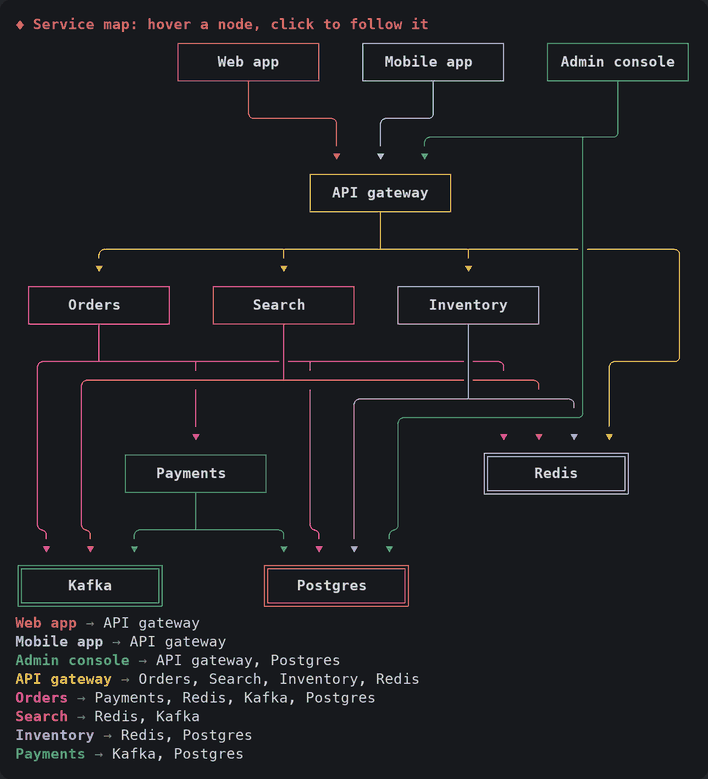

* **Hover a node**: Every wire leaving that node lights up end-to-end; hovering truncated text reveals the full text in the bottom status bar.
* **Click a node's name**: Its incoming and outgoing wires turn thick (`┏┓┗┛━┃`), sit on top of other wires, and animate a bright pulse flowing from source to target for 30 seconds. Click again to clear, or click another node to switch focus.
* **Smooth Entrance Animations**: Charts (`chart`), KPI tiles (`metrics`), roadmaps (`timeline`), and user journeys (`journey`) animate in over 12 frames.
* **One-Click Copy & Export**: Use the top-right **`Copy Text`** button to copy the raw Unicode card, or **`Save PNG`** to download a crisp Retina PNG image.

---

## Installation & Usage Guide

### Step 1: Install the Plugin

Install directly from GitHub:

```bash
agy plugin install https://github.com/Doubletaps76/agy-sketch-plugin
```

Or clone locally and install:

```bash
git clone https://github.com/Doubletaps76/agy-sketch-plugin.git
cd agy-sketch-plugin
agy plugin install .
```

### Step 2: Verify Installation

1. Check from your shell that `sketch` is installed and `enabled`:
   ```bash
   agy plugin list
   ```
2. **Finding `sketch` inside the `/plugin` menu**:
   * When you type `/plugin` inside `agy`, the panel opens on the **`Discover`** tab (which only lists remote plugins from `antigravity-plugins-official`).
   * Press **`Tab`** (or left/right arrow keys) to switch to the **`Installed`** tab, or run `/plugin list`, where you will see **`sketch`**.
   * If you installed the plugin while an `agy` session was already running, restart `agy` (`agy -c` to resume) so the MCP server tools are mounted.

### Step 3: Everyday Usage

You do not need any special slash commands—just ask naturally:

* **Architecture & Wiring**: *"Draw the layered architecture and request flow of this project"*
* **Sequences & Workflows**: *"Draw a sequence diagram for the OAuth login flow"*, *"Draw a swimlane diagram for the refund approval process"*
* **Data Models**: *"Draw an ER schema for users, orders, and payments"*
* **Planning & Decisions**: *"Create a Q3 roadmap timeline"*, *"Compare Postgres, MongoDB, and DynamoDB for our workload"*
* **Explicit Tool Naming**: You can also name a specific tool directly, e.g., *"Use `quadrant` to prioritize these 6 features"* or *"Use `gitgraph` to show our release branching strategy"*.

### Step 4: Opening the Interactive View from the Terminal

Below each drawn card, the agent includes a local preview URL and file path:

1. **Click the Local HTTP URL**:
   * `Cmd + Click` (or `Cmd + Shift + Click` / `Option + Cmd + Click` when `agy` is running in fullscreen AltScreen mode) the `http://127.0.0.1:18923/card/...` link to open the interactive card in your browser while the session is active.
2. **Open the Self-Contained HTML File Anytime**:
   * Every drawn card is also saved as a standalone file under `/tmp/sketch-cards/`:
     ```bash
     open /tmp/sketch-cards/<card-slug>.html
     ```

---

## All 17 Visual Card Tools

| Tool | Draws | Good for |
| --- | --- | --- |
| `layers` | Bands of components, nested zones, side concerns | Tech stacks, platform maps, deployment topologies |
| `diagram` | Nodes and wires, laid out automatically (`flow`, `zones`, `matrix`) | Architecture wiring, flowcharts, state machines, boundaries (C4), dependencies |
| `schema` | Boxes with fields (`pk`/`fk`), and their relations | Data models (ER), class and component diagrams |
| `swimlane` | Steps across lanes of roles or systems | Processes with handovers |
| `pipeline` | Stages left to right, each a column of jobs | CI/CD, ETL, data flows |
| `gitgraph` | Branches, commits, merges and tags | Branching strategy, release flow |
| `sequence` | Actors and the messages between them | Request flows, protocols, handoffs |
| `tree` | An outline (`list`) or a mind map (`mindmap`) | Goal breakdowns, sitemaps, taxonomies |
| `timeline` | Bars over periods, milestones | Roadmaps, gantt schedules, study plans |
| `board` | Columns of cards | Kanban, now / next / later |
| `quadrant` | Points on two axes, or four lists | Prioritisation, positioning, SWOT |
| `journey` | Stages, a mood line, rows of notes | User journeys, service blueprints |
| `wireframe` | A low-fidelity screen (`desktop` or `mobile`) | Page and app layouts |
| `metrics` | Number tiles with a trend | KPIs, experiment results |
| `chart` | Bar, column, stacked, line, scatter, heatmap, histogram, funnel, share | Any numbers you already have |
| `cards` | Titled cards with tags and quotes | Personas, research findings, principles |
| `compare` | Options side by side with pros, cons, effort, and recommendation | Decisions between two to four options |

## Gallery


| Flowchart | Dependencies |
| --- | --- |
|  | 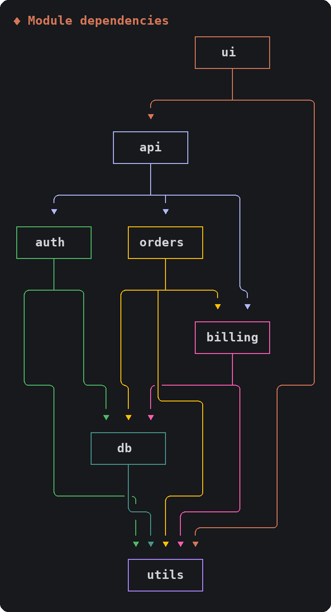 |


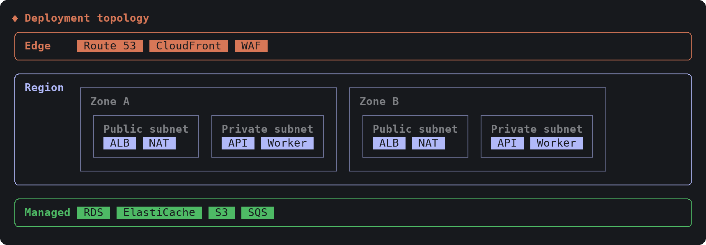

| Data model (ER) | Classes |
| --- | --- |
|  | 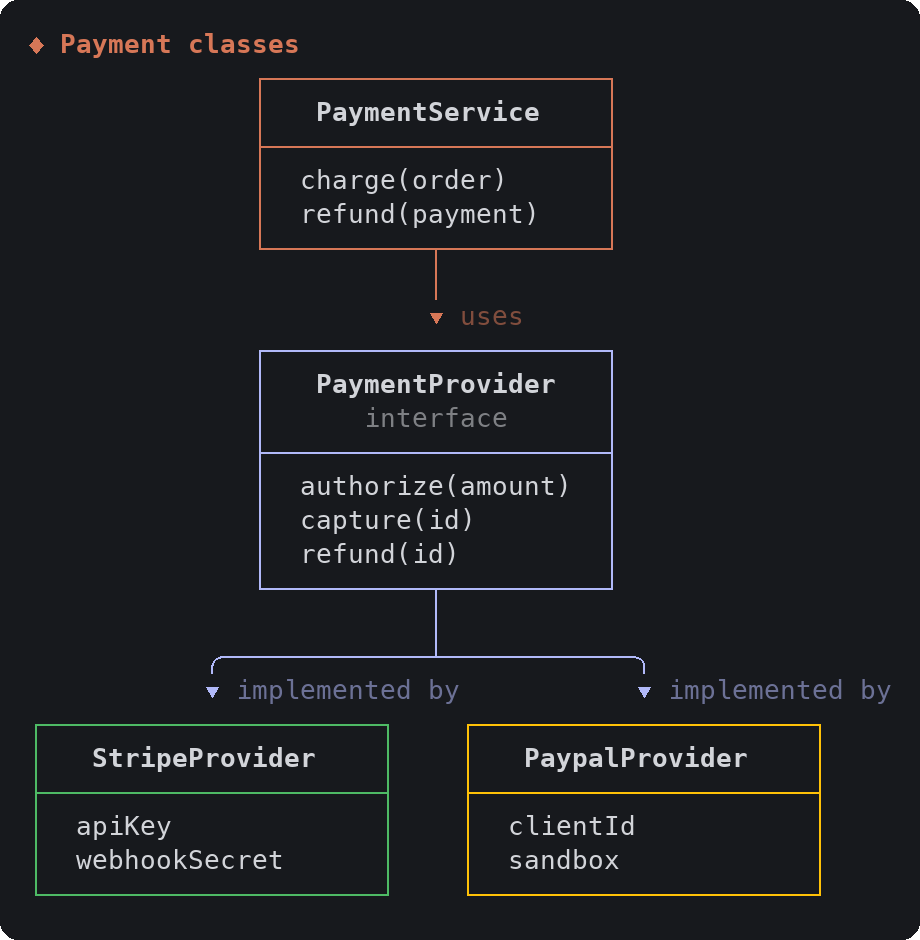 |

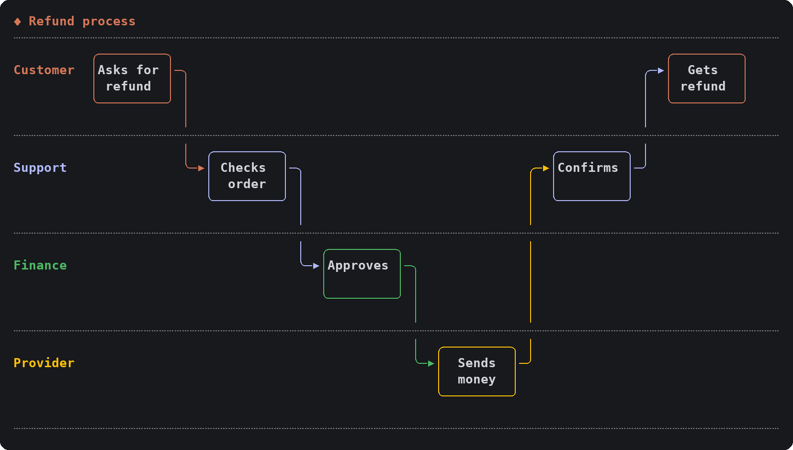


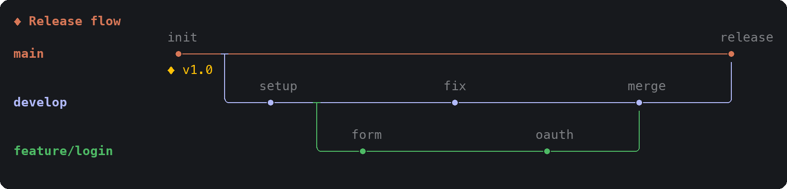


| Outline | Mind map |
| --- | --- |
|  |  |

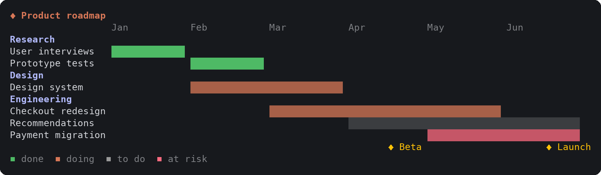


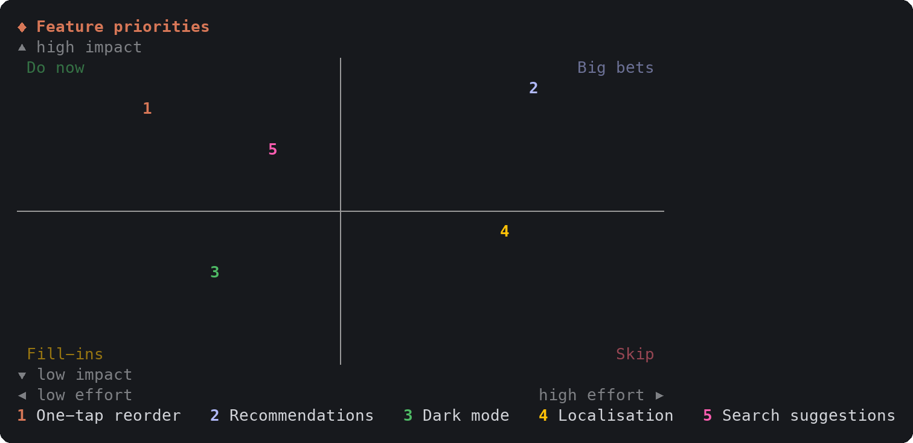

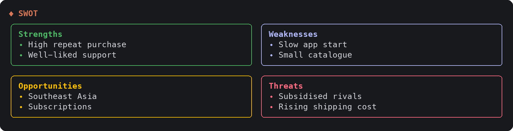

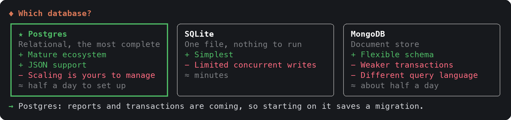


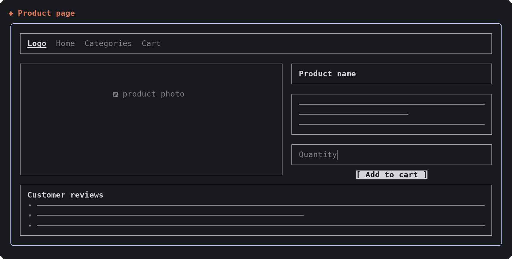


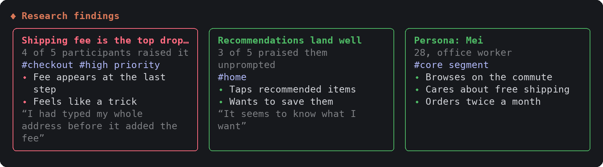

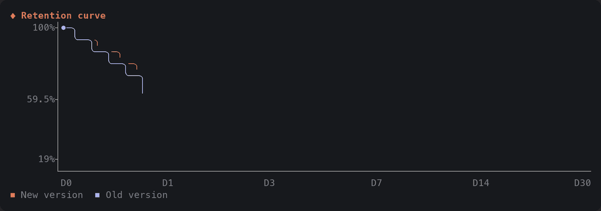

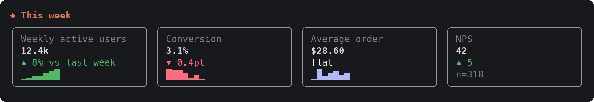

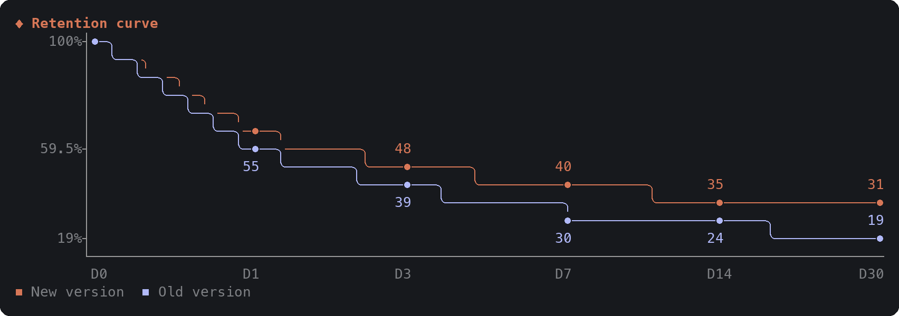


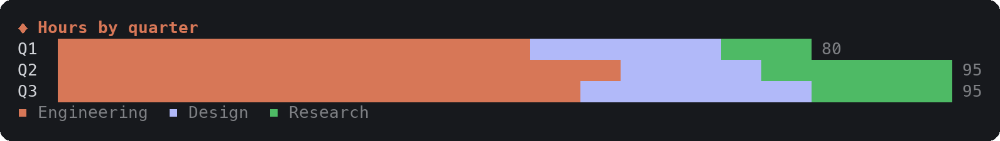

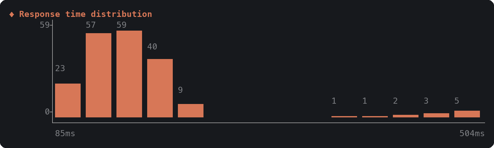


---

## Development & Validation

```bash
node scripts/build.mjs                 # Compile src/*.ts into zero-dependency bin/*.mjs
node scripts/test.mjs                  # Run full test suite
agy plugin validate . --strict         # Validate plugin structure with zero warnings
```

## Credits & License

* Inspired by and adapted from [allen-hsu/claude-code-sketch](https://github.com/allen-hsu/claude-code-sketch).
* MIT License
