# agy-sketch-plugin

[English](README.md) | 繁體中文

**讓 Google Antigravity (`agy`) 用結構化圖卡回答，不再是一大段純文字。**

`agy-sketch-plugin` 是參考 [`claude-code-sketch`](https://github.com/allen-hsu/claude-code-sketch) 為 **Google Antigravity (`agy`)** 重新設計與實作的原生 Plugin 版本。它將原本的 **17 種繪圖工具與自動排版引擎**完整移植為 Antigravity 的 **MCP Server + Rules + Skills + 互動式 Canvas 檢視器**，讓架構、流程、路線圖、使用者旅程、線框圖與數據圖表直接以視覺圖卡呈現。


---

## 核心差異說明：Claude Code vs. Antigravity (`agy`) 底層終端機架構

由於 **Claude Code** 與 **Antigravity (`agy`)** 的底層終端機（TUI）渲染架構與 Plugin 擴充機制完全不同，本專案在實作與互動呈現上與原版 `claude-code-sketch` 有著本質上的差異：

| 比較項目 | Claude Code (`claude-code-sketch`) | Google Antigravity (`agy-sketch-plugin`) |
| :--- | :--- | :--- |
| **底層 TUI 渲染引擎** | **Node.js / Bun + React (Ink)** 元件樹 | **Go 原生編譯執行檔 + BubbleTea** 終端機渲染引擎 |
| **終端機 UI Hook 能力** | 開放內部 `ui.render` (`ToolUse`) JSX Hook，允許外掛注入自訂 `<ui.Box>`、`<ui.Text hover>` 與 `<ui.Button onPress>` 直接替換對話中的工具列並攔截終端機滑鼠座標 | **不開放**第三方外掛注入自訂 Go/JSX 互動元件至終端機文字列；外掛系統採標準化的 **MCP Server (`mcp_config.json`)**、**Rules (`rules/AGENTS.md`)**、**Skills (`skills/`)** 與 **Web MCP App (`ui://`)** |
| **終端機 (`agy` CLI) 內呈現方式** | 直接將工具呼叫列替換為可點擊的動態 TUI 元件 | 在 `agy` CLI 中，MCP 工具呼叫預設會被折疊為一行摘要；因此本外掛由 `sketch-mcp` 運算好 **Unicode Box-Drawing 圖卡**後回傳，並透過常駐規則指示 Agent **直接將繪製好的圖卡印在回覆的程式碼區塊中**（終端機內的文字圖卡為靜態文字，無法在終端機文字列上直接觸發 Hover 或 Click 重繪） |
| **互動探索（Hover 亮線／Click 脈衝光點）** | 在支援滑鼠回報的全螢幕終端機內直接 Hover / Click | **雙軌互動機制**：<br>1. **Antigravity IDE / Desktop GUI**：透過標準 MCP App (`ui://sketch/card.html`) 直接內嵌 HTML5 Canvas 互動卡片。<br>2. **`agy` CLI 終端機**：由常駐的 `sketch-mcp` 自動啟動本地輕量 HTTP 預覽服務 (`http://127.0.0.1:18923/card/<id>`) 並輸出 `/tmp/sketch-cards/*.html` 自包含互動頁面，點開即可在瀏覽器享受 100% 完整的 Hover 亮線、Click 聚焦粗線與流動光點動畫 |
| **系統提示詞與選圖引導** | 透過 `prompt.compose` Hook 動態插入 | 透過 Antigravity 原生 [`rules/AGENTS.md`](rules/AGENTS.md)（常駐規則）與 [`skills/sketch/SKILL.md`](skills/sketch/SKILL.md)（漸進式載入技能）引導模型 |

---

## 這個 Plugin 能做什麼？

### 1. 在終端機對話中直接畫出 17 種高精度 Box-Drawing 視覺圖卡
當你的問題具有「結構、連線、時序、階層、排程或數量」形狀時，Agent 會自動呼叫對應的 `sketch` MCP 工具，透過內建的排版引擎（支援 **Sugiyama 分層連線路由**、**Braille 2×4 點陣折線／散佈圖**、**CJK 全形中文字寬精確對齊**）算出圖卡並直接顯示在終端機回覆中，省去閱讀冗長文字段落的負擔。

### 2. 提供完整的 HTML5 Canvas 互動式圖卡檢視器
針對線條複雜的架構圖 (`diagram`)、資料表關係圖 (`schema`) 或數據圖表 (`chart`)，每次呼叫工具時都會同步產出互動式 HTML5 Canvas 頁面：


* **滑鼠停留 (Hover)**：停留在節點上時，從它出去的每條連線都會從頭到尾亮起來；停留在被截斷的文字上時，卡片底部狀態列會顯示完整內容。
* **點擊節點 (Click to Focus + Pulse Flow)**：點擊節點名稱（或密集圖表下方清單中的節點名稱），進出該節點的連線會變粗 (`┏┓┗┛━┃`)、壓在最上層，並有一段亮光從起點流向終點（持續 30 秒後停止流動並保留粗線；再點一次取消聚焦，點別的節點則切換聚焦）。
* **逐步繪製入場動畫 (Entrance Animation)**：圖表 (`chart`)、指標 (`metrics`)、時間軸 (`timeline`) 與旅程圖 (`journey`) 在打開時會以 12 格平滑動畫逐步畫出。
* **一鍵複製與匯出圖片**：互動式卡片右上角提供 **`Copy Text`**（複製純文字 Box-Drawing 圖卡）與 **`Save PNG`**（下載高解析度 Retina PNG 圖片）按鈕。

---

## 安裝與使用指南

### 步驟 1：安裝外掛

從 GitHub 直接安裝：

```bash
agy plugin install https://github.com/Doubletaps76/agy-sketch-plugin
```

或是 Clone 到本地後安裝：

```bash
git clone https://github.com/Doubletaps76/agy-sketch-plugin.git
cd agy-sketch-plugin
agy plugin install .
```

### 步驟 2：確認安裝狀態與啟用

1. 在終端機執行以下指令確認 `sketch` 已在已安裝清單中且為 `enabled`：
   ```bash
   agy plugin list
   ```
2. **在 `agy` 互動介面中使用 `/plugin` 查看時的注意事項**：
   * 輸入 `/plugin` 開啟外掛面板時，預設停留在 **`Discover`** 分頁（僅顯示官方線上 Marketplace 外掛）。
   * 請按 **`Tab` 鍵**（或左右方向鍵）切換至 **`Installed`** 分頁，或直接輸入 `/plugin list`，即可看到本機安裝的 **`sketch`** 外掛。
   * 若您是在 `agy` 對話開啟期間才執行安裝，請**重啟一次 `agy`**（可使用 `agy -c` 延續對話），讓 `sketch` 的 MCP Server 工具完整掛載進對話環境。

### 步驟 3：日常對話如何使用

安裝完成後**不需要記憶任何特殊語法**，直接用日常語言提問即可：

* **詢問系統架構**：「幫我畫出目前專案的分層架構圖與資料流」
* **詢問流程與時序**：「畫出 OAuth 登入與 Token 刷新的時序圖」、「畫出退款審核的跨部門泳道圖」
* **詢問資料模型**：「幫我設計電商訂單、商品與會員的 ER Schema 圖」
* **詢問產品規劃與決策**：「幫我規劃 Q3 產品路線圖」、「用 compare 比較 PostgreSQL、MongoDB 與 DynamoDB 三種方案」
* **指定特定圖卡**：你也可以直接在對話中點名工具，例如「用 `quadrant` 畫出這五個功能的優先順序」、「用 `gitgraph` 畫出我們的發版分支策略」。

### 步驟 4：如何在終端機開啟「互動式圖卡」

當 Agent 畫出圖卡後，會在圖卡下方附上本地預覽網址與檔案路徑，你可以透過以下任一方式開啟互動檢視器：

1. **點擊本地 HTTP 預覽網址**：
   * 在一般終端機按住 **`Cmd + 點擊`**（若在 `agy` 全螢幕 AltScreen 模式下，部分終端機如 Ghostty / iTerm2 需按住 **`Cmd + Shift + 點擊`** 或 **`Option + Cmd + 點擊`**）點擊回覆下方的 `http://127.0.0.1:18923/card/...` 網址（注意：該網址由當前對話的 `sketch-mcp` 程序提供，對話進行期間皆有效）。
2. **直接開啟本地自包含 HTML 檔案**：
   * 每次繪製的互動式圖卡也會自動保存在 `/tmp/sketch-cards/` 目錄下，隨時可在終端機執行：
     ```bash
     open /tmp/sketch-cards/<圖卡名稱>.html
     ```
     該 HTML 檔已內嵌完整繪圖引擎與圖卡資料，不需網路或伺服器即可獨立運作與互動。

---

## 支援的 17 種視覺圖卡一覽

| 工具 | 畫什麼 | 適合用在 |
| --- | --- | --- |
| `layers` | 一層一層的元件、可巢狀的分區 (`zones`)、橫跨各層的面向 (`sides`) | 技術堆疊、平台地圖、雲端部署拓撲 |
| `diagram` | 節點與連線，自動排版（支援 `flow`、`zones`、`matrix` 三種佈局與 6 種節點形狀） | 架構連線、流程圖、狀態機、邊界（C4）、相依關係 |
| `schema` | 帶欄位的方塊（`pk` / `fk`）與彼此的關係 (`1:1`, `1:N`, `N:N`, `extends`, `uses`) | 資料模型（ER 圖）、類別圖與元件圖 |
| `swimlane` | 依角色或系統分道的步驟 | 有交接的跨角色／跨系統流程 |
| `pipeline` | 由左到右的階段，每個階段一欄工作（支援 `done`/`doing`/`todo`/`risk` 狀態） | CI/CD、ETL、建置與資料流 |
| `gitgraph` | 分支、提交、合併與標籤 | 分支策略、發版流程 |
| `sequence` | 參與者與彼此之間的訊息（支援 `isReply` 虛線回傳箭頭） | 請求流程、協定、交接 |
| `tree` | 大綱 (`list`) 或心智圖 (`mindmap`) | 目標拆解 (OKR)、網站地圖、分類與目錄結構 |
| `timeline` | 跨時段的長條與里程碑 | 路線圖、甘特圖、讀書與專案計畫 |
| `board` | 一欄一欄的卡片 | 看板 (Kanban)、現在／接下來／以後 |
| `quadrant` | 兩個軸上的點，或四個清單 | 優先順序矩陣、市場定位、SWOT 分析 |
| `journey` | 階段、1~5 情緒曲線、多列筆記 | 使用者旅程、服務藍圖 |
| `wireframe` | 低擬真的畫面草圖（支援 `desktop` 與 `mobile`） | 網頁與 App 版面草圖 |
| `metrics` | 數字方塊與走勢（含 Braille 走勢線與漲跌幅度） | KPI 儀表板、實驗結果 |
| `chart` | 長條 (`bar`)、直條 (`column`)、堆疊 (`stacked`)、折線 (`line`)、散佈 (`scatter`)、熱力圖 (`heatmap`)、直方圖 (`histogram`)、漏斗 (`funnel`)、佔比 (`share`) | 任何你手上已有的量化數據 |
| `cards` | 帶標籤、重點與引言的資訊卡 | 人物誌 (Persona)、研究發現、設計原則 |
| `compare` | 並排的 2~4 個方案卡片（含優缺點、成本與推薦標記 `★`） | 在多個架構或產品方案之間做決定 |

以下預覽圖皆由 [`preview/samples.zh-TW.ts`](preview/samples.zh-TW.ts) 中的範例資料透過本專案引擎實際渲染產生。

## 架構與結構

`layers` 呈現系統由什麼組成。`diagram` 呈現它們怎麼連接：每個節點的線各有自己的顏色；往回連的線以向上的箭頭表示；節點的形狀代表它的角色（判斷、儲存、外部系統）。加上 `numbers: true` 會替節點編號，並在箭頭旁標出來源。

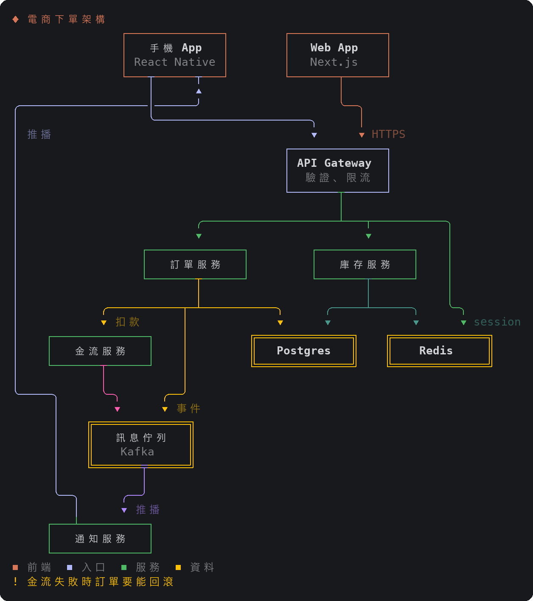

| 流程圖 | 相依關係 |
| --- | --- |
| 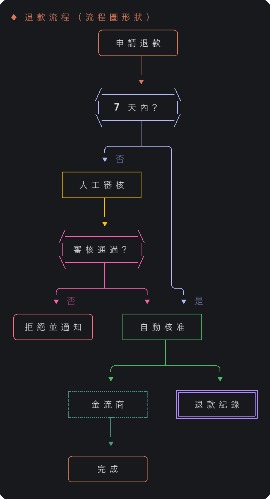 |  |

相依關係太密、線畫不清楚時，用 `layout: "matrix"` 改畫成矩陣，並附上統計：


用 `layout: "zones"` 時，每個群組會變成一個有框線的區塊：子系統、網路邊界、C4 容器圖都能畫。`person` 形狀代表使用者或角色。


節點連回自己的線會畫成節點裡的迴圈，所以狀態機也是一種連線圖：


`layers` 的分區裡可以再放分區，可以用來畫部署拓撲（區域、可用區、子網）：

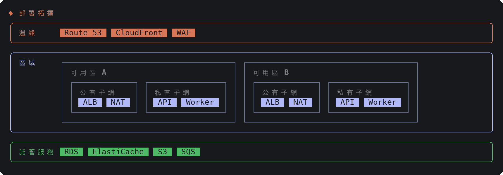

`schema` 畫出資料表或類別和它們的欄位，以及彼此的關係：

| 資料模型（ER） | 類別圖 |
| --- | --- |
|  |  |

`swimlane` 把流程的每一步放在負責者的泳道裡；`pipeline` 把階段由左到右排開；`gitgraph` 呈現分支隨時間的變化：


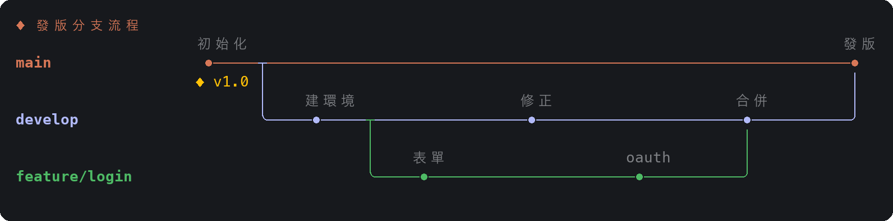

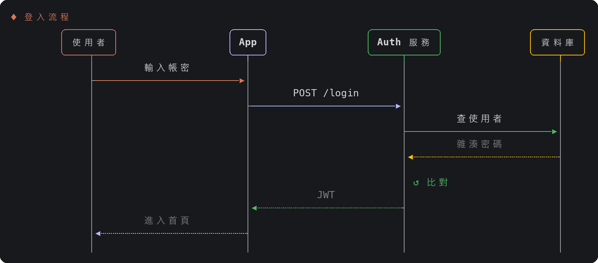

| 大綱 | 心智圖 |
| --- | --- |
|  |  |

## 產品與規劃


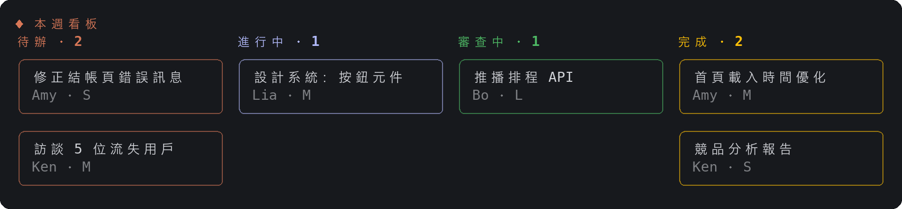


## 設計與研究


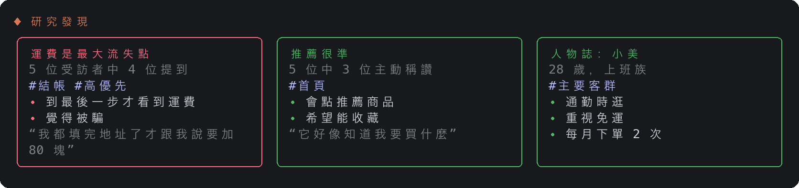

## 數字与圖表

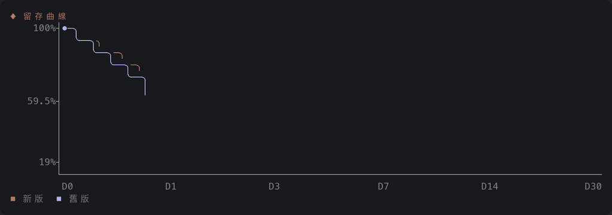


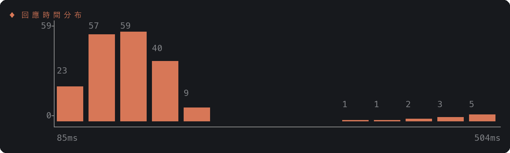

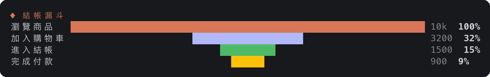

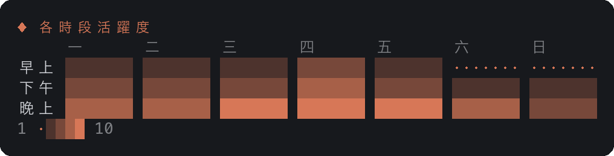

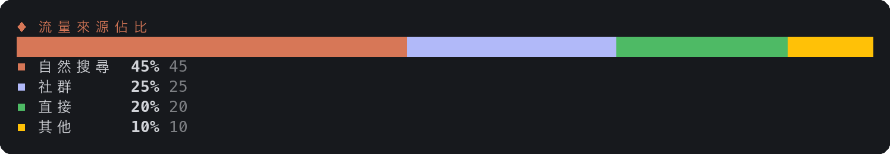

---

## 專案目錄結構與開發指令

```text
agy-sketch-plugin/
├── plugin.json              # Antigravity 原生外掛設定檔
├── mcp_config.json          # 註冊 sketch MCP Server
├── assets/logo.svg          # 外掛向量圖示
├── rules/AGENTS.md          # 常駐規則：指示 Agent 自動選用圖卡並直接輸出至終端機
├── skills/sketch/SKILL.md   # 17 種繪圖工具的選用矩陣與參數指引
├── src/
│   ├── engine.ts            # 17 種圖卡核心解析、Sugiyama 路由與盒模型排版引擎
│   ├── app-ui.ts            # HTML5 Canvas 互動式圖卡渲染器 (支援 MCP App 與獨立開啟)
│   ├── mcp-server.ts        # Stdio MCP 伺服器 + 本地 127.0.0.1 互動預覽服務
│   └── hook-handler.ts      # Lifecycle Hook 輔助模組
├── bin/                     # 預先編譯的零外部依賴 ES Module 執行檔
├── preview/                 # 範例資料集與 PNG / GIF 預覽圖生成工具
└── scripts/                 # 建置 (build.mjs) 與自動化測試 (test.mjs)
```

### 常用開發與驗證指令

```bash
node scripts/build.mjs                 # 將 src/*.ts 編譯為零依賴的 bin/*.mjs
node scripts/test.mjs                  # 執行完整測試（17 種工具、英中範例集、MCP JSON-RPC）
agy plugin validate . --strict         # 執行 Antigravity 官方外掛規範嚴格檢查
agy plugin uninstall sketch && agy plugin install .   # 重新安裝並套用最新修改
```

## 致謝與授權

* 原作靈感與核心排版演算法來自 [allen-hsu/claude-code-sketch](https://github.com/allen-hsu/claude-code-sketch)。
* MIT License
