# sketch (Antigravity / AGY Plugin 版)

[English](README.md) | 繁體中文

**讓 Antigravity (`agy`) 用圖回答，不再是一大段文字。**

`sketch` 是專為 Google Antigravity (`agy`) 打造的視覺化外掛（移植自 [`claude-code-sketch`](https://github.com/allen-hsu/claude-code-sketch)）。它提供給 Agent **17 種繪圖工具**、互動式 **MCP App 介面 (`ui://sketch/card.html`)**、**終端機 TUI 自動內嵌渲染 Hook**，外加一條固定的指示：答案有形狀的時候，就把形狀畫出來。架構、流程、路線圖、使用者旅程、線框圖、圖表，都會以卡片的形式直接出現在對話裡，顏色跟著你的主題走。

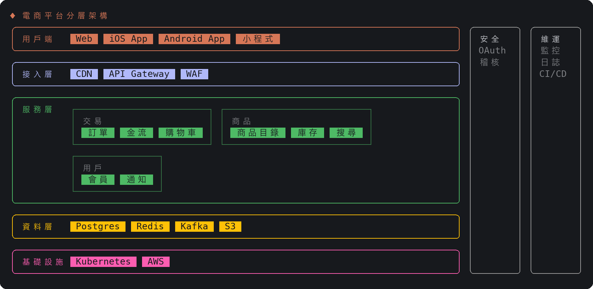

## 可以互動的架構圖

線再多的圖也看得懂，因為你可以一次只看一個節點：

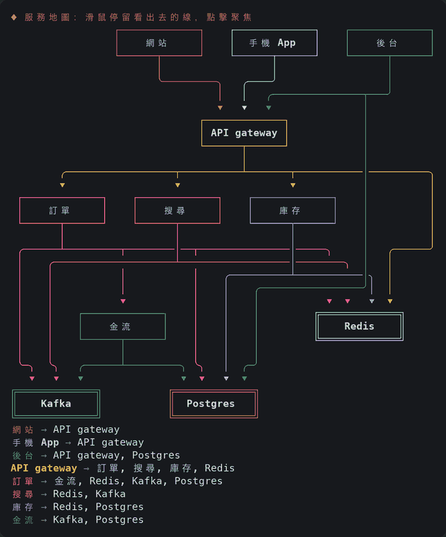

- **滑鼠停留**在節點上：從它出去的每條線都會從頭到尾亮起來。
- **點擊**節點名稱（框中間那一整排都可以點，線很多時圖下清單裡的名稱也可以）：它進出的線變粗、壓在最上層，還會有一段亮光從起點流向終點；其他線變淡。再點一次取消，點別的節點就切換過去。每張卡片各自記住聚焦哪個節點。
- 每個節點的線各有自己的顏色。兩條線交叉時，後畫的直接疊在上面，不畫接點，所以不會誤以為兩條線是相連的。
- 交叉一多，圖下也會用文字列出每一條連線。
- 方塊放不下的文字（管線圖的工作、泳道圖的步驟、節點名稱或說明、路線圖項目）會先換成兩行；還是放不下的，滑鼠停在上面時，卡片最下面那一行會顯示完整內容。

流動效果在最後一次點擊 30 秒後停止，粗線保留；流動期間每秒會重畫那張卡片幾次。卡片右上角還提供一鍵複製純文字（Copy Text）與下載高解析度圖片（Save PNG）按鈕。

## 安裝

### 方式一：透過 `agy` CLI 安裝

```bash
agy plugin install https://github.com/Doubletaps76/agy-sketch-plugin
```

或從本地資料夾安裝：

```bash
git clone https://github.com/Doubletaps76/agy-sketch-plugin.git
agy plugin install ./agy-sketch-plugin
```

### 方式二：直接放入全域 Plugins 目錄

將專案 Clone 至 Antigravity 的全域外掛目錄 (`~/.gemini/config/plugins/sketch`) 即可自動載入：

```bash
git clone https://github.com/Doubletaps76/agy-sketch-plugin.git ~/.gemini/config/plugins/sketch
```

裝好後照平常問就好：「這個服務是怎麼組成的？」「比較這三個方案」「規劃下一季」。要畫哪種卡片由 Agent 自動決定。

## 有哪些卡片

| 工具 | 畫什麼 | 適合用在 |
| --- | --- | --- |
| `layers` | 一層一層的元件、可巢狀的分區、橫跨各層的面向 | 技術堆疊、平台地圖、部署拓撲 |
| `diagram` | 節點與連線，自動排版 | 架構連線、流程圖、狀態機、邊界（C4）、相依關係 |
| `schema` | 帶欄位的方塊與彼此的關係 | 資料模型（ER）、類別圖與元件圖 |
| `swimlane` | 依角色或系統分道的步驟 | 有交接的流程 |
| `pipeline` | 由左到右的階段，每個階段一欄工作 | CI/CD、ETL、資料流 |
| `gitgraph` | 分支、提交、合併與標籤 | 分支策略、發版流程 |
| `sequence` | 參與者與彼此之間的訊息 | 請求流程、協定、交接 |
| `tree` | 大綱或心智圖 | 目標拆解、網站地圖、分類 |
| `timeline` | 跨時段的長條與里程碑 | 路線圖、甘特圖、讀書計畫 |
| `board` | 一欄一欄的卡片 | 看板、現在／接下來／以後 |
| `quadrant` | 兩個軸上的點，或四個清單 | 優先順序、定位、SWOT |
| `journey` | 階段、情緒曲線、多列筆記 | 使用者旅程、服務藍圖 |
| `wireframe` | 低擬真的畫面草圖 | 網頁與 App 版面 |
| `metrics` | 數字方塊與走勢 | KPI、實驗結果 |
| `chart` | 長條、直條、堆疊、折線、散佈、熱力圖、直方圖、漏斗、佔比 | 任何你手上已有的數字 |
| `cards` | 帶標籤與引言的資訊卡 | 人物誌、研究發現、設計原則 |
| `compare` | 並排的選項，加上選擇對話框 | 在二到四個方案之間做決定 |

以下卡片都是用 [`preview/samples.zh-TW.ts`](preview/samples.zh-TW.ts) 裡的虛構資料畫的。

## 架構與結構

`layers` 呈現系統由什麼組成。`diagram` 呈現它們怎麼連接：每個節點的線各有自己的顏色；往回連的線以向上的箭頭表示；節點的形狀代表它的角色（判斷、儲存、外部系統）。加上 `numbers: true` 會替節點編號，並在箭頭旁標出來源。


| 流程圖 | 相依關係 |
| --- | --- |
|  | 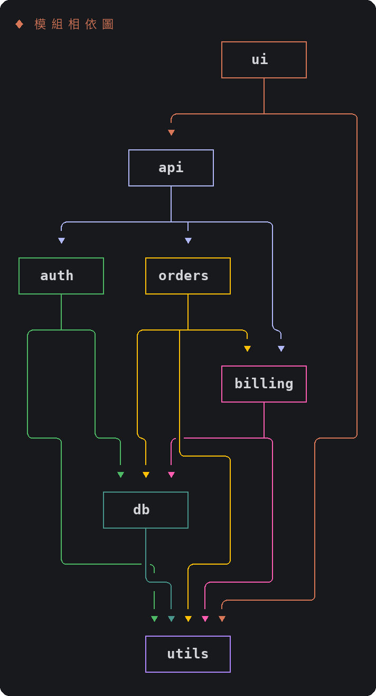 |

相依關係太密、線畫不清楚時，用 `layout: "matrix"` 改畫成矩陣，並附上統計：

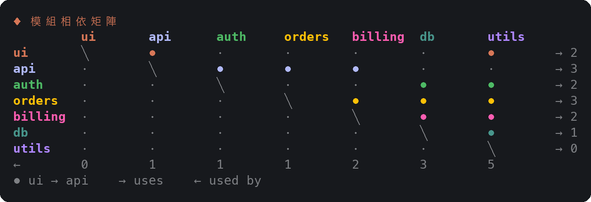

用 `layout: "zones"` 時，每個群組會變成一個有框線的區塊：子系統、網路邊界、C4 容器圖都能畫。`person` 形狀代表使用者或角色。

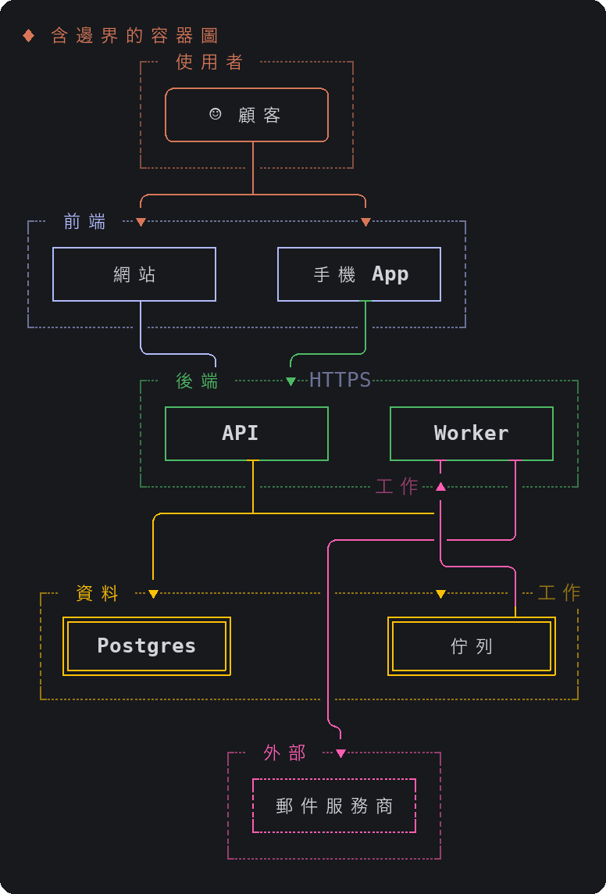

節點連回自己的線會畫成節點裡的迴圈，所以狀態機也是一種連線圖：

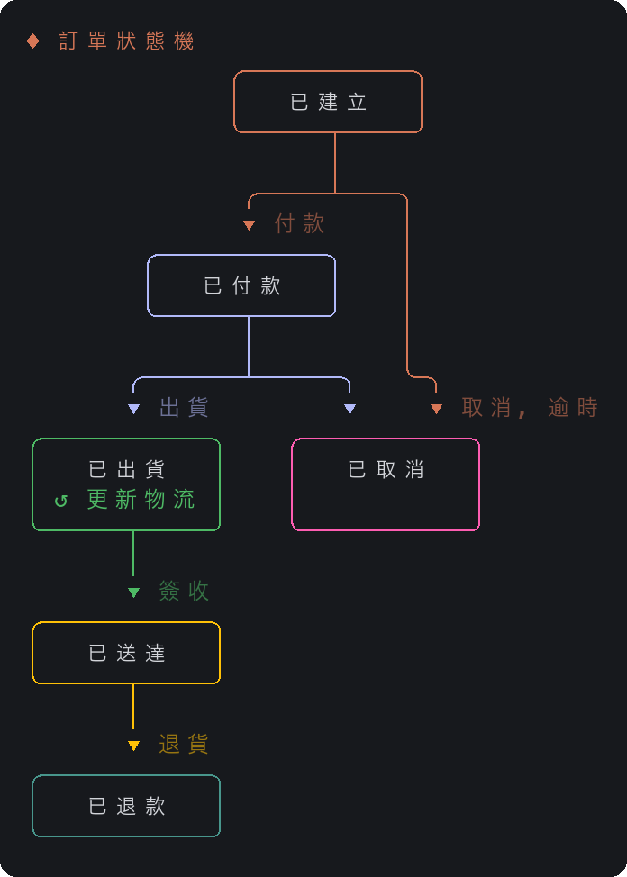

`layers` 的分區裡可以再放分區，可以用來畫部署拓撲（區域、可用區、子網）：


`schema` 畫出資料表或類別和它們的欄位，以及彼此的關係：

| 資料模型（ER） | 類別圖 |
| --- | --- |
| 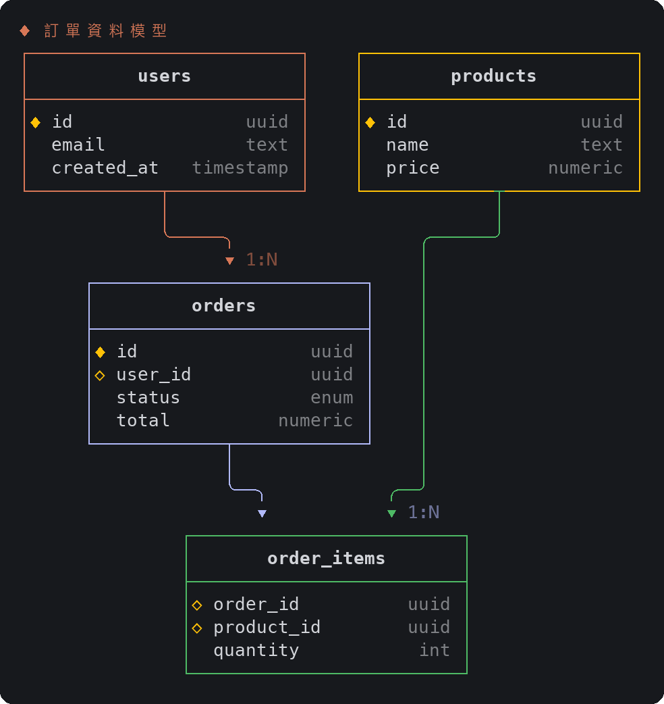 | 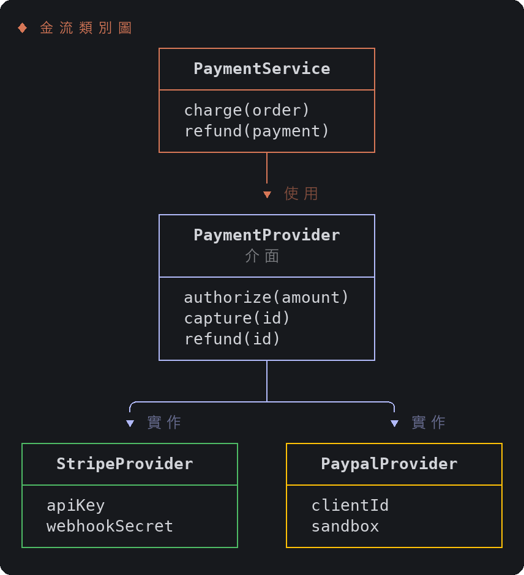 |

`swimlane` 把流程的每一步放在負責者的泳道裡；`pipeline` 把階段由左到右排開；`gitgraph` 呈現分支隨時間的變化：

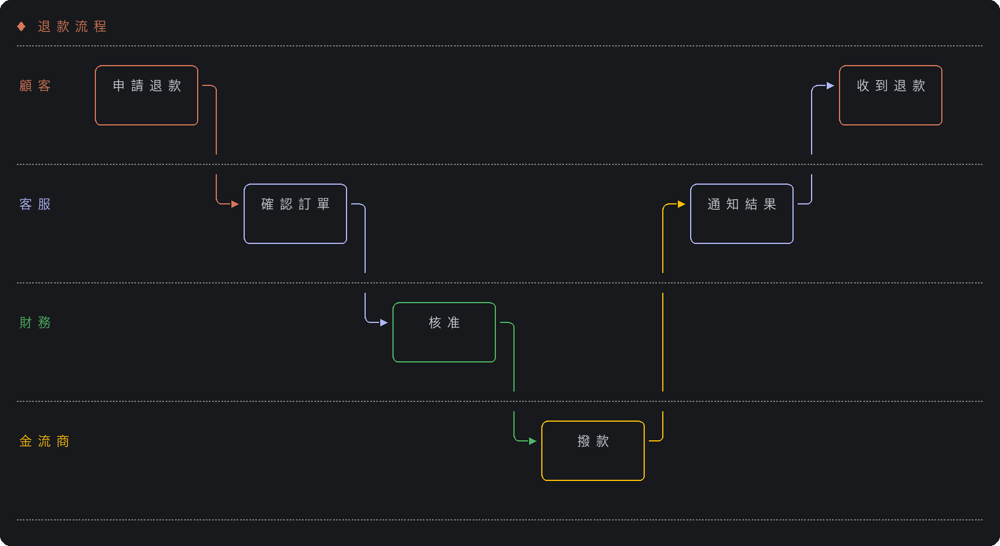

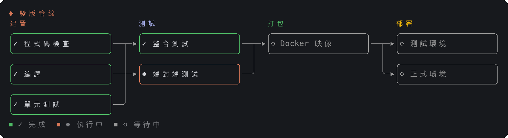


| 大綱 | 心智圖 |
| --- | --- |
| 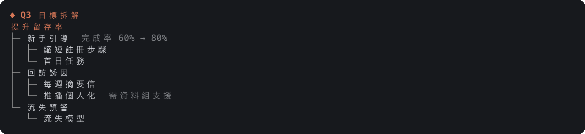 | 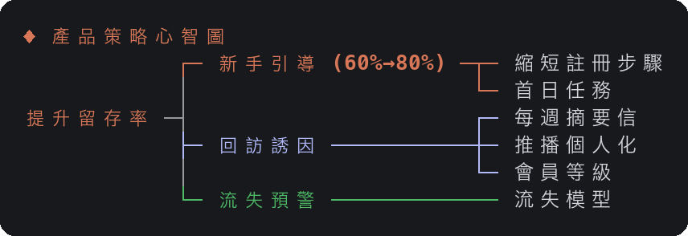 |

## 產品與規劃

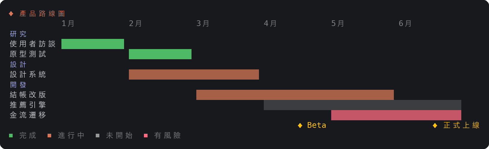


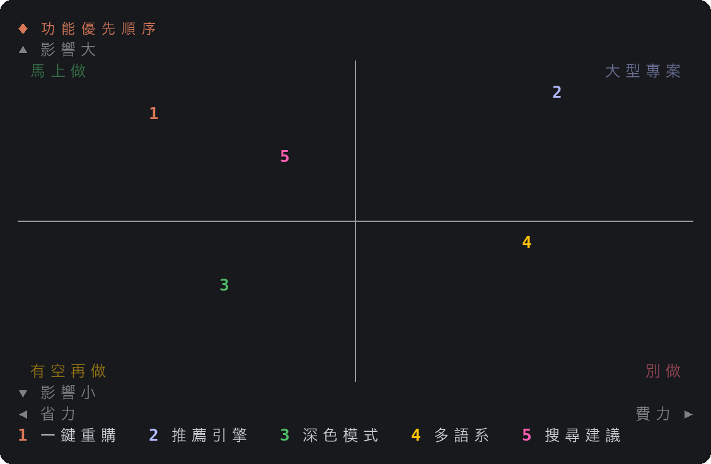

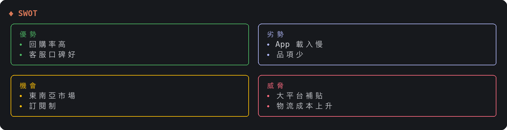

`compare` 畫出選項後，會在卡片下方呈現互動選擇列，點選方案後 Agent 會直接照你選的繼續做。

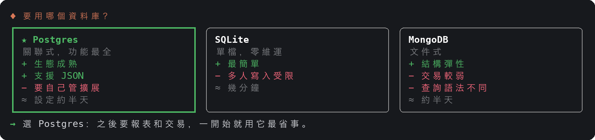

## 設計與研究

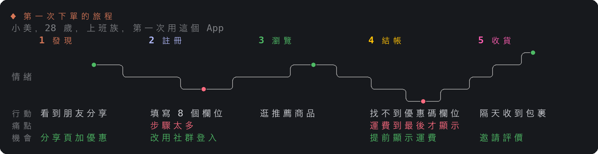

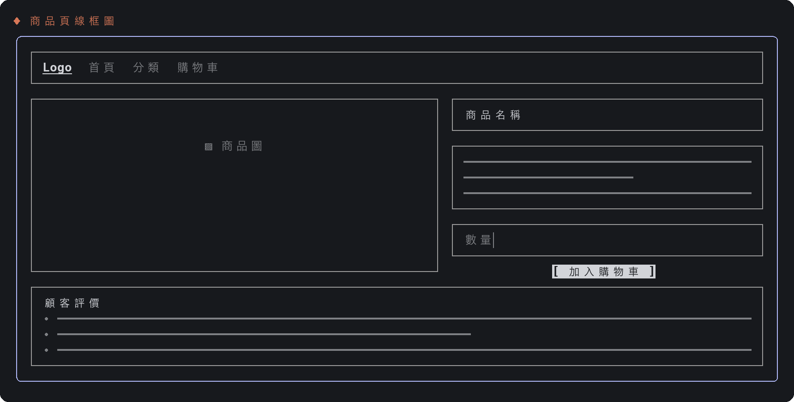

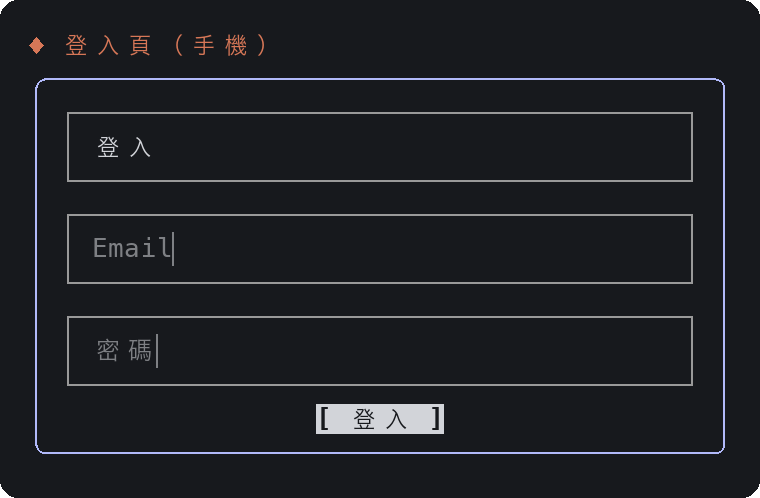


## 數字

圖表、指標方塊、時間軸和旅程圖，在繪製時會逐步畫出來：


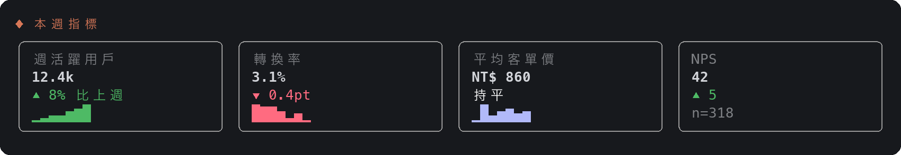

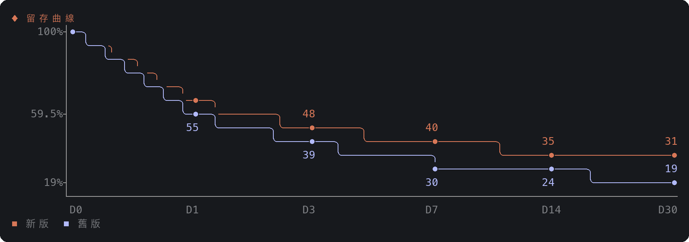

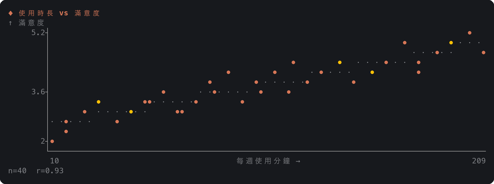

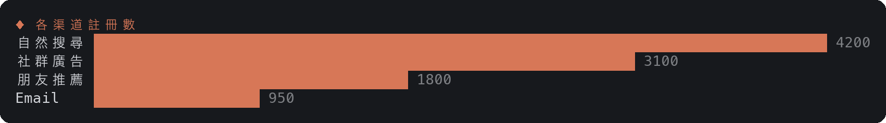

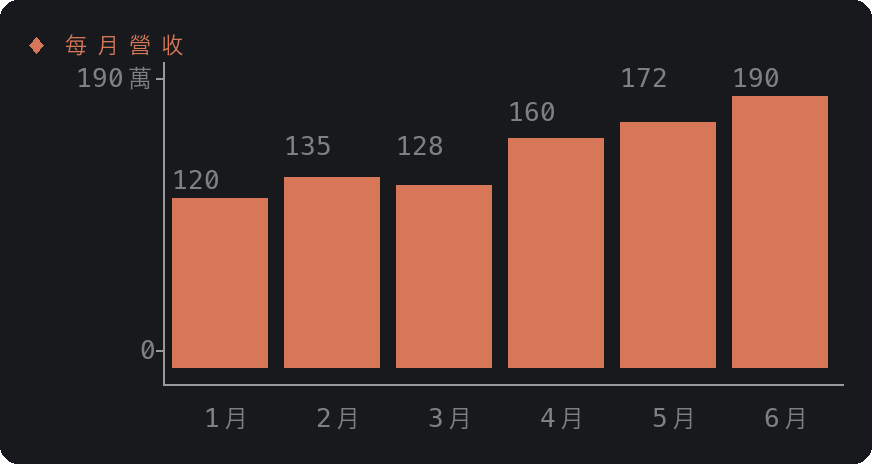

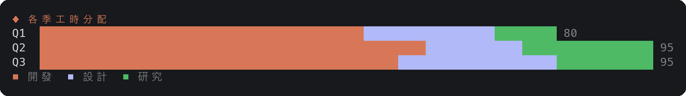


## 在 Antigravity (`agy`) 中的運作方式

本外掛整合了 Antigravity 的四大原生擴充機制：

1. **核心排版與繪圖引擎 ([`src/engine.ts`](src/engine.ts))**：完整實作 17 種結構化圖卡解析器、Sugiyama 分層連線自動路由、Braille 高解析度折線與散佈圖繪製、CJK 全形字元寬度計算與彈性盒模型排版。
2. **MCP 伺服器 ([`src/mcp-server.ts`](src/mcp-server.ts) & [`mcp_config.json`](mcp_config.json))**：透過標準 Stdio JSON-RPC 註冊 17 個繪圖工具，並提供 `ui://sketch/card.html` (`text/html;profile=mcp-app`) 互動式應用程式資源。
3. **互動式 MCP App 介面 ([`src/app-ui.ts`](src/app-ui.ts))**：在 Antigravity 2.0 與 Antigravity IDE 的對話中直接嵌入高解析度 HTML5 Canvas 圖卡，支援滑鼠停留 (Hover) 高亮整條連線、點擊 (Click) 節點聚焦粗線與 30 秒流動光點動畫、入場動畫、`compare` 方案選擇器、深淺色主題即時同步，以及一鍵複製文字／下載 PNG。
4. **CLI Hook 與視覺回答規則 ([`hooks.json`](hooks.json)、[`rules/AGENTS.md`](rules/AGENTS.md)、[`skills/sketch/SKILL.md`](skills/sketch/SKILL.md))**：在 `agy` 終端機 TUI 透過 `metadata.user_markdown` 將繪製好的 Box-Drawing 圖卡直接顯示在對話中（且不額外消耗模型 Token），並指示 Agent 在答案有形狀時自動畫出對應卡片。

## 重新產生預覽圖片

在 macOS / Linux 下重新產生預覽圖與動畫（需要 Node.js 22+ 與裝有 Pillow 的 Python 3）：

```bash
node preview/render.ts src/engine.ts 110 preview/cards.json ./samples.zh-TW.ts
python3 preview/paint.py preview/cards.json docs/images/zh-TW
node preview/frames.ts src/engine.ts 110 ./samples.zh-TW.ts preview/anim
SKETCH_GIF_SCALE=0.55 python3 preview/paint.py preview/anim-interaction.frames.json docs/images/zh-TW/interaction.gif
python3 preview/paint.py preview/anim-entrance.frames.json docs/images/zh-TW/entrance.gif
```

英文版請改用 `samples.en.ts` 和 `docs/images/en`。

## 開發與驗證

```bash
npm run build                # 將 TypeScript 編譯為零依賴的 bin/*.mjs 執行檔
npm test                     # 執行完整自動化測試（17 種工具、英中範例集、MCP 伺服器、Hook）
agy plugin validate . --strict
```

## 授權

MIT
